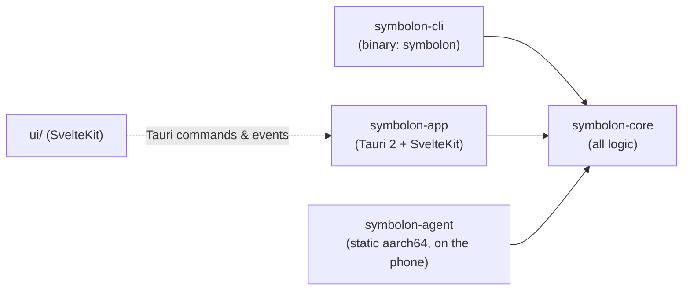
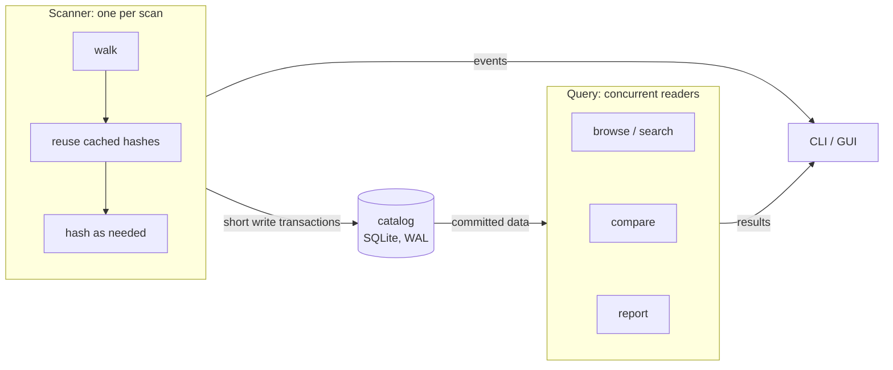
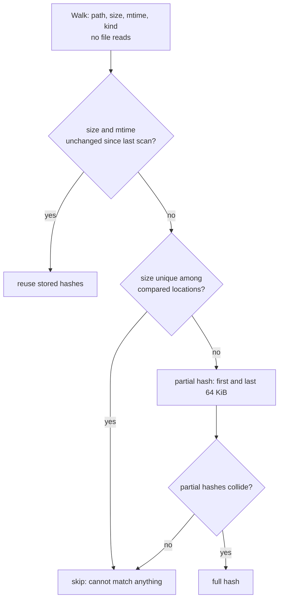
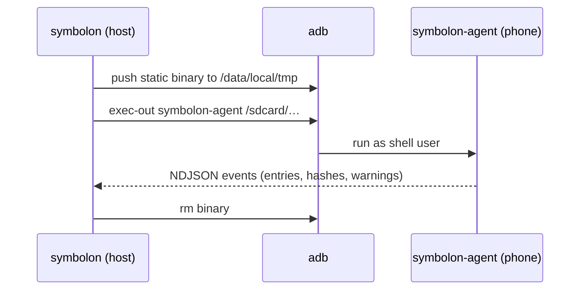
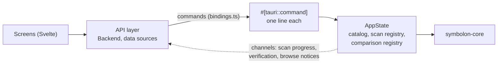

# Architecture

This chapter describes how the pieces fit. Items marked _(planned)_ do not exist yet; the milestone that brings them is in brackets.

## Crates

`symbolon-core` depends on none of the other crates and needs no async runtime. Everything a user can do is a core API call; the clients only parse input, call core and render output. Platform-specific parts of core (ADB, device identity) sit behind Cargo features so a mobile app could reuse the pure logic ([ADR-0006](adr/0006-core-feature-gates.md)).

## Two halves: `Scanner` and `Query`

Core exposes two independent APIs over one catalog:

- **`Scanner`** scans one location, writes entries in short transactions and streams events over a channel. It supports cancel and pause.
- **`Query`** is read-only. It uses separate SQLite connections in WAL mode, so it can browse partial results while a scan is still writing.
- **`Comparison`** compares two or more sides (locations or subpaths) from the catalog. It copies the compared entries into temporary tables on its own connection, classifies them with SQL, and serves a summary, rows by cursor or by offset in path or size order, a folder tree with totals, and counts by extension and size; `resolve` hashes on demand what decides a row ([ADR-0010](adr/0010-comparison-engine.md), [ADR-0023](adr/0023-offset-reads.md)).
- **`Catalog::export` / `Catalog::import`** move one location between catalogs as a `.symbolon` file; imported locations compare like any other but are never scanned ([ADR-0005](adr/0005-export-format-and-import-conflicts.md), [ADR-0013](adr/0013-imported-locations.md)).

Only one scan of a location runs at a time, across processes, enforced by an OS file lock ([ADR-0012](adr/0012-scan-lock.md)). The `symbolon` CLI is a thin client of these APIs: it parses arguments, calls core, and renders tables, JSON or CSV ([ADR-0011](adr/0011-cli-conventions.md), [Command-line usage](cli.md)).

A client may run both in one process (the GUI) or in different processes (a CLI scan in one terminal, a TUI browsing in another).

## Scan pipeline

With the `eager` policy every file gets a full hash during the scan; with `lazy` the pruning steps run when a comparison needs them. See [Concepts → Hash tiers](concepts.md#hash-tiers).

## Concurrency

- Plain threads, [`rayon`](https://docs.rs/rayon) for parallel hashing and [`crossbeam-channel`](https://docs.rs/crossbeam-channel) for events. No `tokio` in core; the Tauri backend wraps blocking calls with `spawn_blocking`.
- Hashing parallelism is capped per device class: I/O, not CPU, is the bottleneck on HDDs, USB sticks and phones. On Android phones, which thread count is fastest depends on the storage: two on a Galaxy A54, eight on a Pixel 10. Four is close to the best on both ([ADR-0018](adr/0018-phone-hashing-threads.md)).
- One writer connection per scan; readers use their own connections. Write transactions stay short so readers are never blocked for long.
- Scan events are best-effort for slow clients: a full buffer drops progress and per-file events instead of pausing the scan; `Finished` is always delivered, and the catalog is the authoritative record.

## Android

Files are hashed on the phone, so only the index crosses USB. If the agent cannot run, a fallback hashes with the phone's own `sha256sum`, guarding against its silent short reads ([ADR-0003](adr/0003-android-agent-musl-spike.md)). The transport sits behind an `AndroidTransport` trait _(planned, M5)_, which tests replace with a mock.

## The desktop app

The app is a thin client of both halves ([ADR-0024](adr/0024-app-core-bridge.md)). Screens talk to a `Backend` interface; its Tauri implementation calls commands that run methods of one long-lived `AppState` on a blocking pool.

- **Locations and browsing** are direct `Catalog` and `Query` calls.
- **Scans** run as in the CLI; a forwarding thread passes their events to the window's channels, throttled, and keeps the latest one for windows that attach later.
- **Comparisons** stay built for as long as a screen shows them. They appear at once from the catalog and are verified in the background; each hashing round refreshes them and tells the screen.

The TypeScript types and command functions in `ui/src/lib/api/bindings.ts` are generated from the Rust signatures (tauri-specta) and checked for drift by `just test`.

## Catalog

One SQLite database (WAL mode, `rusqlite` with bundled SQLite) holds locations, scans and entries. The schema is a versioned public contract with forward-only migrations ([Catalog schema](schema.md)). Paths are stored as raw bytes plus a normalized key ([ADR-0004](adr/0004-raw-path-encoding.md)).

## Where to look next

- The [specification](start.md) for requirements and milestones.
- The [decision records](adr/index.md) for why things are the way they are.
- The [API reference](development/api.md) for the code itself.
